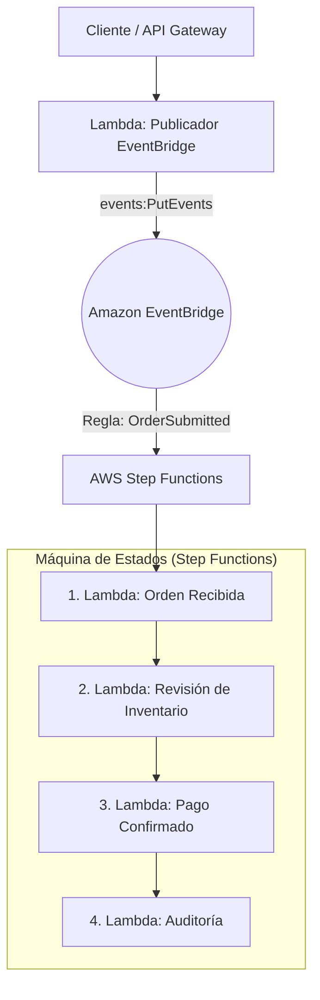

# Orquestación de Órdenes con AWS Step Functions, EventBridge y Lambda

Arquitectura *serverless* orientada a eventos para gestionar el ciclo de vida de una orden de compra de forma desacoplada, trazable y tolerante a fallos mediante **Amazon EventBridge**, **AWS Step Functions** y **AWS Lambda**.

---

## Arquitectura del Flujo

El diagrama se renderiza automáticamente en GitHub gracias a Mermaid:



---

## Componentes del Sistema

### 1. Ingesta y Enrutamiento de Eventos
* **Lambda de EventBridge (`eventbridge-publisher`):** Punto de entrada que recibe la solicitud externa, normaliza los datos y publica un evento personalizado en el bus de EventBridge utilizando la acción `events:PutEvents`.
* **Amazon EventBridge:** Evalúa el evento entrante mediante una regla de filtrado (`detail-type: "OrderSubmitted"`) y dispara la ejecución de la máquina de estados en Step Functions pasándole el payload JSON como entrada.

### 2. Pasos de la Máquina de Estados (Step Functions)
1. **Lambda Orden Recibida (`orden-recibida`):** Valida el esquema de la orden, asigna un identificador único de seguimiento y registra el estado inicial (`RECIBIDA`).
2. **Lambda Revisión de Inventario (`revision-inventario`):** Consulta la disponibilidad de los artículos solicitados y realiza la reserva temporal de stock.
3. **Lambda Pago Confirmado (`pago-confirmado`):** Verifica la aprobación de la pasarela de pagos y consolida la transacción (`PAGADA`).
4. **Lambda Auditoría (`auditoria`):** Recopila los metadatos, marcas de tiempo y resultados de cada etapa previa para almacenar una traza inmutable de auditoría y cumplimiento.

---

## Ejemplo de Evento (EventBridge)

Estructura JSON enviada por la **Lambda de EventBridge** hacia el bus de eventos:

```json
{
  "Source": "com.tienda.ordenes",
  "DetailType": "OrderSubmitted",
  "EventBusName": "default",
  "Detail": {
    "orderId": "ORD-2026-00981",
    "customerId": "USR-4521",
    "items": [
      { "sku": "PROD-101", "quantity": 2, "price": 45.00 }
    ],
    "totalAmount": 90.00,
    "currency": "USD"
  }
}
```

---

## Definición de la Máquina de Estados (ASL)

Ejemplo base en *Amazon States Language* con reintentos automáticos ante fallos transitorios:

```json
{
  "Comment": "Flujo secuencial de procesamiento y auditoría de órdenes",
  "StartAt": "OrdenRecibida",
  "States": {
    "OrdenRecibida": {
      "Type": "Task",
      "Resource": "arn:aws:states:::lambda:invoke",
      "Parameters": {
        "FunctionName": "arn:aws:lambda:REGION:ACCOUNT_ID:function:orden-recibida",
        "Payload.$": "$.detail"
      },
      "Retry": [
        {
          "ErrorEquals": ["States.TaskFailed"],
          "IntervalSeconds": 2,
          "MaxAttempts": 3,
          "BackoffRate": 2.0
        }
      ],
      "Next": "RevisionInventario"
    },
    "RevisionInventario": {
      "Type": "Task",
      "Resource": "arn:aws:states:::lambda:invoke",
      "Parameters": {
        "FunctionName": "arn:aws:lambda:REGION:ACCOUNT_ID:function:revision-inventario",
        "Payload.$": "$.Payload"
      },
      "Next": "PagoConfirmado"
    },
    "PagoConfirmado": {
      "Type": "Task",
      "Resource": "arn:aws:states:::lambda:invoke",
      "Parameters": {
        "FunctionName": "arn:aws:lambda:REGION:ACCOUNT_ID:function:pago-confirmado",
        "Payload.$": "$.Payload"
      },
      "Next": "Auditoria"
    },
    "Auditoria": {
      "Type": "Task",
      "Resource": "arn:aws:states:::lambda:invoke",
      "Parameters": {
        "FunctionName": "arn:aws:lambda:REGION:ACCOUNT_ID:function:auditoria",
        "Payload.$": "$.Payload"
      },
      "End": true
    }
  }
}
```

---

## Permisos IAM Requeridos

| Recurso | Acción IAM | Propósito |
| :--- | :--- | :--- |
| **Lambda EventBridge** | `events:PutEvents` | Publicar el evento inicial en el bus de EventBridge. |
| **Regla EventBridge** | `states:StartExecution` | Iniciar la máquina de estados al coincidir el patrón del evento. |
| **AWS Step Functions** | `lambda:InvokeFunction` | Invocar secuencialmente las 4 funciones Lambda del flujo. |
| **Todas las Lambdas** | `logs:CreateLogGroup`, `logs:PutLogEvents` | Escribir registros de ejecución en Amazon CloudWatch. |

---

## Estructura del Repositorio

```text
├── lambdas/
│   ├── eventbridge-publisher/   # Publica eventos en EventBridge (PutEvents)
│   ├── orden-recibida/          # Validación e ingreso de la orden
│   ├── revision-inventario/     # Verificación y reserva de stock
│   ├── pago-confirmado/         # Validación del pago
│   └── auditoria/               # Registro de trazabilidad del flujo
├── statemachine/
│   └── order-workflow.asl.json  # Definición JSON de Step Functions
└── README.md
```
